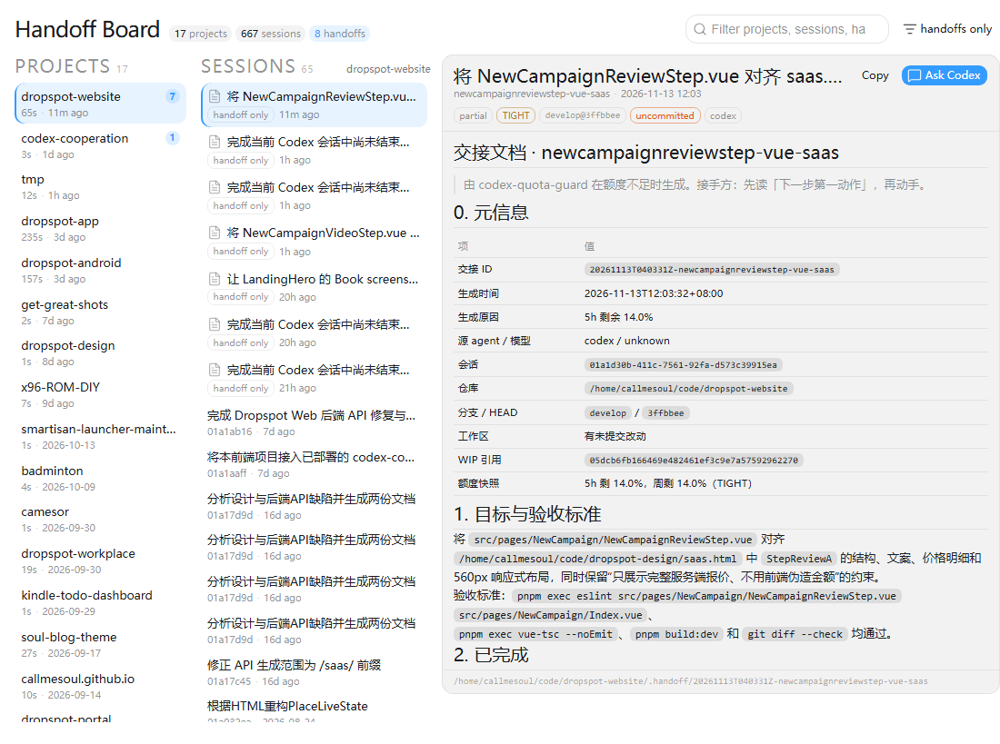
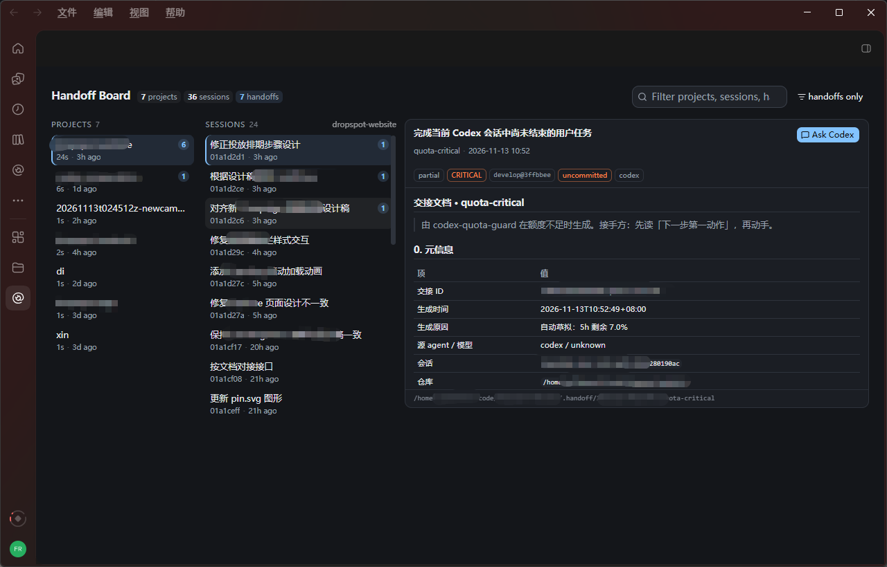
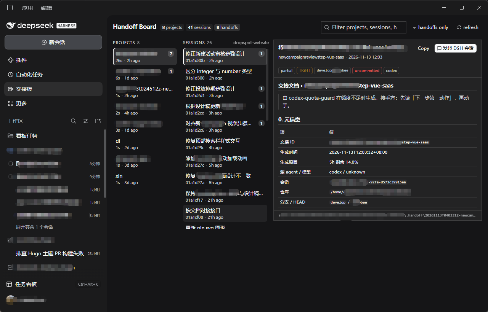

# codex-quota-guard

给 Codex 加一条**配额护栏**：读得到账号还剩多少额度，判定当前任务做不完就拦下昂贵操作，先把现场写成一份另一个 agent 能直接接手的交接文档，再停。

一句话分工：**hooks 负责「何时看、看不下去就拦」，`SKILL.md` 负责「看到了怎么想」，`AGENTS.md` 负责「别忘了看」。**

额度是「账号 + 时间窗」的函数，5 小时窗口可能在你写到一半时用完。没有护栏时，代价是上下文白烧、任务停在半路、下一个会话从零猜。这个仓库把这件事做成确定性的：不再依赖模型「想起来看一眼」。

## 它做什么

| 能力 | 表现 |
|---|---|
| 读额度 | 5 小时窗口 + 周窗口的剩余百分比、重置时间、burn rate（`%/轮`） |
| 判定 | `OK` / `TIGHT` / `CRITICAL` / `EXHAUSTED` / `WAIT_RESET` / `UNKNOWN` 六级 |
| 拦截 | `CRITICAL` 之后只放行现场采集与写交接，昂贵命令（install/build/test/deploy/git push…）直接 deny |
| 逼收尾 | 一轮结束时交接文档还有 TODO，`Stop` hook 会 block，不让会话「悄悄结束」 |
| 交接 | `<repo>/.handoff/<utc>-<slug>/HANDOFF.md` + `handoff.json`，十段结构，自包含 |
| 浏览 | Handoff Board 面板：按项目 → 会话 → 交接文档三列浏览，可从面板直接开下一个会话 |



## 架构

三层叠加，确定性逻辑全部下沉到 hooks：

```
┌──────────────────────────────────────────────────────────────┐
│ L1 确定性层  ~/.codex/hooks.json → quota_guard.py hook ...    │
│   SessionStart / UserPromptSubmit / PreToolUse /              │
│   PostToolUse / PostModelRequest / PreCompact / Stop          │
│   职责：读额度、算等级、写 gate.json、必要时 deny / block      │
└───────────────────────────┬──────────────────────────────────┘
                            │ 读写
              ~/.codex/quota-guard/gate.json  （唯一真源）
                            │ 读
┌───────────────────────────┴──────────────────────────────────┐
│ L2 技能层  SKILL.md（codex-quota-guard）                      │
│   职责：判定口径 / 估算公式 / 暂停协议 / 交接文档 schema       │
└───────────────────────────┬──────────────────────────────────┘
                            │ 引用
┌───────────────────────────┴──────────────────────────────────┐
│ L3 指令层  ~/.codex/AGENTS.md                                  │
│   几行硬规则 + 指向 SKILL.md，保证压缩后仍在                   │
└──────────────────────────────────────────────────────────────┘
```

为什么要三层：skill 走隐式调用，模型读到 `name + description` 才决定要不要读全文，描述写得再宽也是概率事件；`AGENTS.md` 每轮重读但同样不保证；只有 hooks 是系统执行、不经模型。所以「必须发生」的事只放在 hooks 里。

## 取数：优先本地，兜底 app-server

1. **当前会话 rollout 尾部**（`$CODEX_HOME/sessions/<Y>/<M>/<D>/rollout-*.jsonl` 里的 `rate_limits`）——零成本，毫秒级。文件可能几百 KB，所以从尾部 seek 64KB 反向解析。
2. **`codex app-server` 的 `account/rateLimits/read`**——1~3 秒，只在 rollout 缺失、过期或账号对不上时用。

窗口口径：`primary` = 5 小时（300 分钟），`secondary` = 周（10080 分钟）。只有 `window_minutes == 300` 才叫「5 小时」，不按顺序猜。

**切换账号**会立即作废缓存：护栏用 `~/.codex/auth.json` 的 `tokens.account_id`（以及 `/mnt/c/Users/*/.codex/auth.json`）认账号，与 `gate.json` 里记的上一个账号比对；不一致就直接问 app-server，不受 `cache_ttl_seconds` 限制。新账号还没写过额度行时判定降级为 `UNKNOWN`，并明确标注「额度仍是上一个账号的」——这时不要拿这组数字判断能不能做完。

## 判定与阈值

| 判定 | 条件（默认） | 该做什么 |
|---|---|---|
| `OK` | 剩余充足 | 正常推进 |
| `TIGHT` | 5h 剩 < 15% 或周剩 < 10% | 不扩范围：不重构、不加依赖、不顺手改无关文件 |
| `CRITICAL` | 5h 剩 ≤ 10%，或 burn rate 算出做不完 | 停止任务，只做现场采集与交接 |
| `EXHAUSTED` | 剩余 ≤ 0.5%，或出现 429 / `rate_limit_reached` | 立刻停，先写交接 |
| `WAIT_RESET` | 重置在即，等更划算 | 挂起到 `resets_at` 之后继续（需 `wait_reset.enabled: true`） |
| `UNKNOWN` | 拿不到额度 | **不要停**，继续干活但避免昂贵命令 |

百分比只是估计，**报错是事实**：任何 `rate_limit_reached` / 429 直接按 `EXHAUSTED` 处理。

判定「能不能做完」用 burn rate（EWMA，默认 α = 0.3）：`r5 - reserve - burn × est_turns < 0` 即做不完，其中 `est_turns = 待办项数 × turns_per_item`，`reserve` 给写交接本身预扣 3%。待办项数变了要重跑 `plan`。

所有阈值、节奏、昂贵命令正则都在 [`config/thresholds.yaml`](config/thresholds.yaml)，改配置不用动代码。

## 安装

```bash
cd codex-quota-guard
./install.sh
```

只依赖 Python 3.9+（`install.sh` 自己找 `python3`，并把 `~/.local/bin` 补进 PATH）。第 5 步装插件需要 `codex` 与 `codex plugin` 子命令；`codex` 不在 PATH 时这一步会跳过并打印手动命令，技能与 hooks 仍然装好。

不想自己动手的，跳到 [让 agent 自己装](#让-agent-自己装)。

`install.sh` 六步，全部幂等：

| 步骤 | 做什么 |
|---|---|
| 1/6 链接技能 | 逐项软链 `SKILL.md` `PLAN.md` `scripts` `config` `hooks` `agents` 到 `~/.agents/skills/codex-quota-guard`（**不**暴露 `plugin/`，否则同一技能会被注册两次） |
| 2/6 自检 | `quota_guard.py selftest`，离线跑，不需要真额度 |
| 3/6 合并 hooks | 把 `hooks/hooks.json` 合进 `$CODEX_HOME/hooks.json`，先清掉旧版 quota_guard 条目 |
| 4/6 信任 hooks | `hook_trust.py --apply` 把当前内容 hash 写进 `config.toml` 的 `[hooks.state]` |
| 5/6 装插件 | `codex plugin marketplace add .` + `codex plugin add handoff-board@codex-quota-guard` |
| 6/6 AGENTS.md | 追加 `codex-quota-guard:begin/end` 硬规则块 |

选项：

```bash
./install.sh --also /mnt/c/Users/<you>/.codex   # 顺带装 Codex 桌面版的 home（Windows 侧）
./install.sh --no-plugin                        # 只装技能 + hooks
./install.sh --no-agents                        # 不碰 AGENTS.md
./install.sh --no-trust                         # 不自动写 [hooks.state]，留给人手动信任
./install.sh --uninstall                        # 摘掉 hooks 与软链，保留交接文档
```

> 每个 `CODEX_HOME` 是独立目录，不是同一棵树的两种视图。WSL 里装的技能和插件，桌面版（跑在 Windows 侧 home）看不到。两个 home 都用就加 `--also`。

验证：随便跑一次 Codex 会话，然后看 `~/.codex/quota-guard/hook.log` 有没有新的 `SessionStart` / `Stop` 记录。**没有记录 = hook 没被信任**（失效的 hook 是静默跳过的），重跑 `python3 scripts/hook_trust.py --apply`，或在 CLI 里执行 `/hooks`、桌面版 `Settings > Hooks` 手动信任。临时绕过用 `codex --dangerously-bypass-hook-trust`。

### 只装 handoff-board 插件（不用整个仓库）

插件单独也能装 —— `.agents/plugins/marketplace.json` 把 `./plugin` 暴露成一个 marketplace：

```bash
codex plugin marketplace add callmesoul/codex-quota-guard          # GitHub 源
codex plugin add handoff-board@codex-quota-guard
```

想锁版本就 `codex plugin marketplace add callmesoul/codex-quota-guard@v0.4.3`，本地目录直接给路径也行。只想拉子目录就 `--sparse .agents --sparse plugin`（两个都要，少了 `.agents` 会报找不到 manifest）。
插件是**本地 stdio MCP**，跑之前确认那个 home 的 `config.toml` 里有 `[features] enable_mcp_apps = true`。

### 让 agent 自己装

把仓库路径和下面这段一起丢给任意能跑 shell 的 agent（Codex、Claude Code、Cursor 都行），它能自己装完并自检：

```text
在本机安装 codex-quota-guard，装完自检，只报告结果：

1. 先读 <repo>/README.md 的「安装」和「验证」两段，按里面写的做，不要自己发明步骤。
2. cd <repo> && ./install.sh
   桌面版也在用就加 --also /mnt/c/Users/<you>/.codex —— 每个 CODEX_HOME 是独立目录。
3. python3 <repo>/scripts/quota_guard.py selftest 必须打印 SELFTEST OK。
4. 开一次 codex 会话，确认 ~/.codex/quota-guard/hook.log 里出现新的 SessionStart 行。
   没有这行 = hook 没被信任（失效的 hook 静默跳过），跑
   python3 <repo>/scripts/hook_trust.py --apply 后重试。
5. 装完重启 Codex 桌面版，插件才加载。
```

给它准备的硬事实，省得它瞎试：

| 事实 | 说明 |
|---|---|
| `install.sh` 没有 `--help` | 传了直接 `unknown option: --help` 退出 2。选项只有 `--also` `--no-plugin` `--no-agents` `--no-trust` `--uninstall` |
| 装在哪 | 软链到 `~/.agents/skills/codex-quota-guard`（**不是** `~/.codex/skills`，那里不生效）；状态在 `~/.codex/quota-guard/` |
| 幂等 | 六步都能重跑；重跑会先清掉旧 quota_guard hook 条目再加，不会重复 |
| 不需要真额度 | `selftest` 用临时目录跑，不碰真实 `gate.json` |
| 别跑 `codex plugin list` | 它会起 app-server 然后挂住，不是装坏了 |
| 改源码要重装插件 | 插件缓存是拷贝，得 `codex plugin remove` 再 `add` 才生效 |

## 用法

### 命令

```bash
python3 ~/.agents/skills/codex-quota-guard/scripts/quota_guard.py status [--json] [--refresh|--fresh]
```

`status` 输出示例：

```
判定: CRITICAL — 5h 剩余 7.0%
5h: 剩余 7.0%（已用 93.0%），重置 11-13 15:54
周: 剩余 13.0%（已用 87.0%），重置 11-16 14:30
估算: burn 0.613%/轮，待办 4 项 ≈ 6.0 轮
计数: Bash 25，模型请求 28，轮次 6
数据: rollout，11-13 14:20
账号: c843f6cd
```

| 命令 | 用途 |
|---|---|
| `status [--json] [--refresh] [--fresh]` | 看当前判定。`--refresh` 强制重取，`--fresh` 直接问 app-server 不读 rollout |
| `plan --items 7` | 声明本次任务待办项数，判一次可行性 |
| `check [--milestone]` | 主动查一次；`--milestone` 会累加里程碑计数 |
| `handoff --goal "…" [--slug …] [--reason …] [--cwd …]` | 生成交接骨架，打印 `HANDOFF.md` 路径 |
| `selftest` | 离线自检（判定分支、rollout 尾部解析、gate 原子写、交接生成、git 排除），用临时目录，不碰真实 state |
| `hook <EventName>` | hooks 入口，Codex 通过 stdin 传 JSON payload |

`status` 的退出码就是判定，方便脚本用：

| 码 | 判定 |
|---|---|
| 0 | `OK` |
| 10 | `TIGHT` |
| 11 | `CRITICAL` |
| 12 | `EXHAUSTED` |
| 13 | `WAIT_RESET` / `UNKNOWN` |

辅助脚本：

```bash
python3 scripts/quota_status.py [--json] [--raw-json] [--timeout 20]   # 只问 app-server，不读 rollout
python3 scripts/hook_trust.py [--apply] [--home DIR] [--codex PATH]    # 信任 hooks（默认只打印不写）
```

### 检查时机

| 时机 | 谁触发 | 动作 |
|---|---|---|
| 会话开始 / resume / compact / fork | hook | 自动注入护栏，无需操作 |
| 用户新 prompt | hook | 判定异常时注入警告（同等级只提醒一次） |
| 多步任务开工前 | **你** | `plan --items <待办项数>` |
| 每 8 次 Bash / 10 次模型请求 | hook | 自动刷新；TIGHT 后每次本地工具调用前轻量刷新 |
| 昂贵命令前 | hook | `PreToolUse` 拦；被拦时先写交接，或把命令拆小 |
| 每个里程碑完成 | **你** | `check --milestone` |
| 每轮结束 | hook | CRITICAL 且交接仍有 TODO 时 block，逼你写完 |

`PostModelRequest` 只有新版 codex 才有：standalone CLI 0.154.0 没有这个事件，桌面版（0.167 WSL 桥）和 VSCode 扩展（0.169）都有。纯 CLI 收不到时「模型请求」计数会停住，**不影响护栏**——额度刷新由「每 8 次 Bash」和每轮 `Stop` 兜住。

### 暂停协议

判定进入 `CRITICAL` / `EXHAUSTED` 时按顺序做，不许跳步：

1. **停手**：不再派发工具调用，不开新子任务，不回滚已完成改动。
2. **采现场**（`handoff` 会自动做 git 部分）：`git status --porcelain && git diff --stat`。
3. **生成骨架**：`quota_guard.py handoff --goal "<一句话目标>"`。
4. **填九段 TODO**（第 0 段元信息已自动填好）：目标与验收、已完成（带证据）、未完成（有序，含 entry/expect/verify）、关键决策、坑、环境复现、下一步第一动作、待确认问题、resume prompt。留一个没填，接手方就得重新推一遍，交接等于白写。
5. **输出六行暂停摘要**：原因 / 剩余额度 / 交接路径 / 建议接手方式 / 下一步第一动作 / resume 命令。

禁止：伪造完成、悄悄缩范围后交付、把未完成项写成「已实现，待验证」。`WAIT_RESET` 不写交接，直接说明等到几点然后停。

## 交接文档

落在 `<repo>/.handoff/<utc>-<slug>/`，两份文件：

- **`HANDOFF.md`** —— 给人/agent 读。十段，其中第 0 段由脚本填、其余九段要你填：0 元信息表、1 目标与验收标准、2 已完成、3 未完成（每条 entry/expect/verify 四段式）、4 关键决策与理由、5 坑（试过且失败的路）、6 环境与复现、7 下一步第一动作、8 待确认问题、9 可直接粘给下一个 agent 的 resume prompt，末尾附现场快照（`git status --porcelain` 与 `git diff --stat`）。
- **`handoff.json`** —— 给工具读。键：`id` `created_at` `status` `reason` `goal` `source`（agent/model/session_id/transcript）`quota`（verdict/r5/r7/primary/secondary/source）`repo`（path/branch/head/dirty/stash/status/diffstat）`git_exclude` `next_action` `todo`。

`.handoff/` 默认写进 `.git/info/exclude`（本地忽略，不进版本库、不改 `.gitignore`）。交接文档不自动提交。

接手侧：同机另一个 agent 直接读 `HANDOFF.md`，内容自包含；需要可验收任务单时转 `codex-cooperation` 的 `handoffctl create`（可选，不在本技能范围）。

## Handoff Board 面板

三列：项目 → 该项目的会话 → 交接文档本身（从 `HANDOFF.md` 渲染，标题/列表/表格/代码块）。数据只读两个 Codex 已经在写的 store，外加各项目的 `.handoff/`。

同一块面板挂进两个宿主里长这样（截图中的项目名做过模糊处理）：

**Codex 桌面版**——点全局左侧栏的 Handoff Board：



**DeepSeek Harness 桌面版**——点侧栏「交接板」，开在「自动化任务」与「更多」之间：



四种打开方式：

| 方式 | 怎么用 | 前提 |
|---|---|---|
| **Codex 桌面版侧栏** | 点全局左侧栏的 **Handoff Board** | 每个 home 的 `config.toml` 加 `[features] enable_mcp_apps = true`（该特性仍是 under development 且默认关闭） |
| **DSH 桌面版侧栏** | 点侧栏「交接板」，开在「自动化任务」与「更多」之间 | 装 `dsh-plugin/`（见下） |
| **内联可视化** | 会话里问一句「看看交接文档」 | 宿主支持内联可视化（`handoff_board.py marker` 打印内容引用） |
| **本地 HTTP** | `python3 plugin/scripts/handoff_board.py serve --port 8787` | 无 |

`handoff_board.py` 另有 `scan`（JSON 到 stdout）、`render --out FILE [--standalone]`，通用参数 `--root DIR`（可重复，扫额外项目）、`--compact`（只留产出过 handoff 的项目）。

面板源码在 [`panel/handoff-board-panel/`](panel/handoff-board-panel)（Vue 3 + shadcn-vue + Tailwind v4），编译成**单个 HTML 片段** `plugin/assets/panel.fragment.html`：只有内联 `<style>` + `<script>`，宿主 iframe 禁止网络请求，数据从 `<script type="application/json" id="hb-data">` 槽位读入。改完源码要重新构建并重装插件：

```bash
cd panel/handoff-board-panel && npx vue-tsc -b && npx vite build
cp dist/panel.fragment.html ../../plugin/assets/panel.fragment.html
cd ../.. && codex plugin remove handoff-board@codex-quota-guard && codex plugin add handoff-board@codex-quota-guard
```

插件缓存是**拷贝不是软链**，改任何 `plugin/` 下的文件都必须 remove + add 重装。`codex plugin remove` 需要完整的 `<plugin>@<marketplace>` 名字。

### DSH 插件

[`dsh-plugin/`](dsh-plugin) 把同一块面板挂进 DeepSeek Harness 的侧栏（`dsh-handoff-board`）：

```bash
cp -r dsh-plugin "$LOCALAPPDATA/dsh-handoff-board-stage"   # pnpm 不能从 UNC 路径装
dsh plugin --profile desktop add "file:$LOCALAPPDATA/dsh-handoff-board-stage"
```

装完必须重启。面板的 Ask 按钮会调 `uiWorkspace.startSession()` 在工作区里开会话并注入接管提示词——**只预填、不自动提交**，误点一次就会烧额度。详见 [`dsh-plugin/README.md`](dsh-plugin/README.md)。

## 目录结构

```
codex-quota-guard/
├── SKILL.md                    技能正文：取数、判定口径、检查时机、暂停协议、交接 schema
├── PLAN.md                     实现方案与事故记录（1510 行，含每个坑的复现与修法）
├── install.sh                  六步安装 / 卸载
├── config/thresholds.yaml      阈值、节奏、昂贵命令正则
├── hooks/hooks.json            七个事件的定义（安装时替换 __SKILL_DIR__）
├── agents/openai.yaml          agent 清单
├── scripts/
│   ├── quota_guard.py          主脚本：hook 入口 + status/plan/check/handoff/selftest
│   ├── quota_status.py         只走 app-server 读额度
│   └── hook_trust.py           把 hooks 内容 hash 写进 config.toml 的 [hooks.state]
├── plugin/                     Codex 插件 handoff-board
│   ├── .codex-plugin/plugin.json
│   ├── .mcp.json               MCP server 声明（command 必须是 python3）
│   ├── server.py               本地 MCP App 服务端，暴露 open_handoff_board
│   ├── scripts/handoff_board.py  scan / render / serve / marker
│   ├── skills/handoff-board/   面板技能
│   └── assets/                 panel.fragment.html（构建产物）+ 图标
├── panel/handoff-board-panel/  Vue 3 面板源码（Codex 侧与 DSH 侧共用）
├── dsh-plugin/                 DeepSeek Harness 插件（宿主半 + 浏览器半）
├── docs/                       面板与图标截图（panel-1100 / panel-codex-desktop /
│                              panel-dsh-desktop 是三处宿主里的同一块面板）
└── .agents/plugins/marketplace.json   本地 marketplace，暴露 ./plugin
```

仅标准库，无第三方依赖（Python 3.9+，实测 3.11 / 3.12）。面板构建需要 Node `^20.19.0 || >=22.12.0`。

## 环境变量

| 变量 | 作用 |
|---|---|
| `CODEX_HOME` | Codex home，默认 `~/.codex` |
| `QUOTA_GUARD_STATE` | 覆盖状态目录（默认固定 `~/.codex/quota-guard`，**不**跟 `CODEX_HOME` 走） |
| `QUOTA_GUARD_DISABLE` | 设成 `1` 关掉护栏（hook 直接放行） |
| `QUOTA_GUARD_FORCE` | 强制判定（`OK` / `TIGHT` / `CRITICAL` / `EXHAUSTED`），用于演练与自测。**只对 `hook` 入口生效**，`status` 永远读真实额度 |
| `CODEX_MODEL` / `CODEX_THREAD_ID` | 记进交接文档的来源信息 |
| `HANDOFF_BOARD_MCP_LOG` | MCP server 日志路径，默认 `/tmp/handoff-board-mcp.log` |
| `SKILL_DEST` | 覆盖技能安装目录（默认 `~/.agents/skills/codex-quota-guard`） |

## 常见问题

**侧栏有按钮、点开空白。** 桌面版跑的是**它自己那个 home** 的插件缓存，不是 WSL 侧的。先确认两件事：`command` 是 `python3`（桌面版用非登录 shell 的精简 PATH，WSL 里没有 `python`）；`[features] enable_mcp_apps = true` 加在了**那个** home 的 `config.toml` 里。日志看 `HANDOFF_BOARD_MCP_LOG` 指向的文件里有没有 `recv ... method=resources/read`。

**hook 装了但一条没跑。** 非托管 hook 按内容 hash 记信任，改过 `hooks.json`（哪怕只调 timeout）旧 hash 立刻失效，而失效的 hook 是**静默不执行**的。重跑 `hook_trust.py --apply`。

**切换账号后额度看起来不对。** 见上文「切换账号」。判定为 `UNKNOWN` 时不停工，但别信那组数字。

**`codex executable was not found`。** 跑 `codex login status`，必要时 `codex login`。永远不要为了「刷新额度」消耗 rate-limit reset credit——除非用户明确要求。

## 相关文档

- [`SKILL.md`](SKILL.md) —— 技能正文，模型实际读的那份
- [`PLAN.md`](PLAN.md) —— 实现方案与事故记录：为什么这么设计、每个坑怎么发现的
- [`plugin/README.md`](plugin/README.md) —— Codex 插件与面板细节
- [`dsh-plugin/README.md`](dsh-plugin/README.md) —— DSH 插件与宿主/浏览器两半的分工
- [`docs/publishing.md`](docs/publishing.md) —— 把 handoff-board 发布出去的三条通道与自查表

## 许可

插件清单（[`plugin/.codex-plugin/plugin.json`](plugin/.codex-plugin/plugin.json)）标注 MIT。
