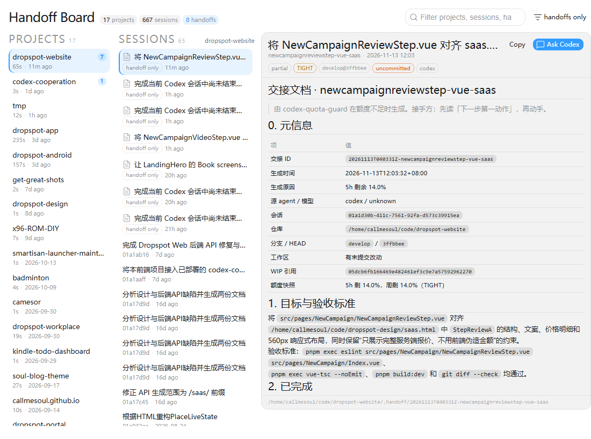

# Handoff Board

A Codex plugin that answers one question: **which project, which session, and exactly what did the
previous session leave behind?**

It joins two stores that Codex already writes and nothing else:

| Source | What it contributes |
|---|---|
| `~/.codex/sessions/<Y>/<M>/<D>/rollout-*.jsonl` | every session, grouped by the `cwd` recorded in its `session_meta` |
| `~/.codex/session_index.jsonl` | the human thread titles |
| `<project>/.handoff/<utc>-<slug>/handoff.json` + `HANDOFF.md` | the handoffs written by `codex-quota-guard` when quota ran out |

## Panel

**Handoff Board** appears as a button in the global left sidebar. Selecting it opens the board
full-screen inside the desktop app. The sidebar entry is registered by the `open_handoff_board` tool
with an OpenAI MCP Extensions `global` entrypoint; the UI resource is rendered directly from local
session and handoff files, so no HTTP server needs to stay running.

MCP Apps are still an under-development feature in the desktop app, so enable them once:

```toml
# ~/.codex/config.toml
[features]
enable_mcp_apps = true
```

The desktop app spawns this server from the plugin cache of whichever `CODEX_HOME` it runs with, and
every home keeps its own copy (a WSL home and a Windows home are separate directories, not one
bind-mounted tree). Install into each one you use — the sidebar entry and the board's own stats both
follow the active home. If the sidebar opens but stays blank, check `plugin/server.py`'s log
(`/tmp/handoff-board-mcp.log`, override with `HANDOFF_BOARD_MCP_LOG`) for
`recv ... method=resources/read`, and the desktop log under
`%LOCALAPPDATA%\Packages\OpenAI.Codex_2p2nqsd0c76g0\LocalCache\Local\Codex\Logs\` for
`Started app widget`.

Three columns: projects → sessions of the selected project → the handoff document itself, rendered
from `HANDOFF.md` (headings, lists, tables, fenced code, tables of metadata). Every colour comes from
host CSS variables, so it follows the light or dark theme where it is embedded.

- Below 820px the layout stacks: projects and sessions become scroll-capped lists above the document.
- A session row tagged `handoff only` is a handoff whose transcript is missing locally.
- **Ask Codex** sends a follow-up asking the next session to read that document and take over the
  unfinished work, and reports the outcome right under the title: `Sent · Codex starts a new turn in
  this chat`, `Copied · paste it into the composer`, or the host's own reason when it refuses (for
  example `Codex is still starting the last turn`). The button is disabled while a request is in
  flight, so a second click cannot race the host.
- **Copy** puts the same takeover prompt on the clipboard without touching the host. When copying fails
  too, the prompt appears in a read-only box under the document so it can still be selected by hand.



The panel is a Vue 3 + shadcn-vue app (`panel/handoff-board-panel/`) compiled to one HTML fragment:
`plugin/assets/panel.fragment.html`. The fragment carries inline `<style>` + `<script>` only — the host
iframe forbids network requests — and reads its data from the `<script type="application/json"
id="hb-data">` slot that `handoff_board.py` fills in. To rebuild after editing the Vue sources:

```bash
cd panel/handoff-board-panel && npx vue-tsc -b && npx vite build
cp dist/panel.fragment.html ../../plugin/assets/panel.fragment.html
```

`plugin/README.md` is shipped inside the plugin cache, so reinstall (below) after any change here.

## Install

```bash
cd <repo> && ./install.sh          # skills + hooks + plugin + AGENTS.md
```

Or by hand, from the repository root:

```bash
codex plugin marketplace add .
codex plugin add handoff-board@codex-quota-guard
```

The plugin cache is a copy, not a symlink, so after editing anything under `plugin/`:

```bash
codex plugin remove handoff-board@codex-quota-guard
codex plugin add handoff-board@codex-quota-guard
```

Each `CODEX_HOME` has its own cache: if you install from WSL but the desktop app runs with the Windows
home, repeat the two commands with `CODEX_HOME` pointing at that home (or run them from Windows).
`codex plugin remove` needs the full `<plugin>@<marketplace>` name; the short name fails with
`plugin requires --marketplace unless passed as <plugin>@<marketplace>`.

## Use

Use the **Handoff Board** button in the desktop app's global left sidebar. As a fallback, inside a
session ask for the board ("show my handoffs"). The skill runs `handoff_board.py marker`,
which writes an HTML fragment to `~/.codex/visualizations/handoff-board/` and prints an inline
visualization content reference; the host renders it in the reply.

Outside a session:

```bash
python3 plugin/scripts/handoff_board.py serve --port 8787   # http://127.0.0.1:8787/
python3 plugin/scripts/handoff_board.py scan                # JSON
python3 plugin/scripts/handoff_board.py render --standalone --out board.html
```

Flags for the three data-producing subcommands: `--root DIR` (repeatable, adds projects outside the
session store), `--compact` (only projects that produced a handoff), `--out FILE`.

## Why not a native panel

Codex plugins load skills, MCP servers, apps, agents, commands and hooks — there is no custom UI
extension point. The only native surfaces for a panel are the inline visualization content reference
and MCP Apps (`features.enable_mcp_apps`, still under development and off by default), so the same
HTML is served inline, over local HTTP, and through `plugin/server.py` as a global sidebar entry.

`server.py` returns its resource as `text/html+skybridge` on purpose: the alternative,
`text/html;profile=mcp-app`, makes the host wait for `ui/initialize` +
`ui/notifications/initialized` from the widget, and a static page has no bridge to send them, so the
host gives up after five seconds. `text/html+skybridge` is accepted without that handshake. Its
stdout is written as raw UTF-8 bytes (`sys.stdout.buffer`) because the inherited console code page on
Windows cannot encode the CJK and symbol characters in the board payload.
